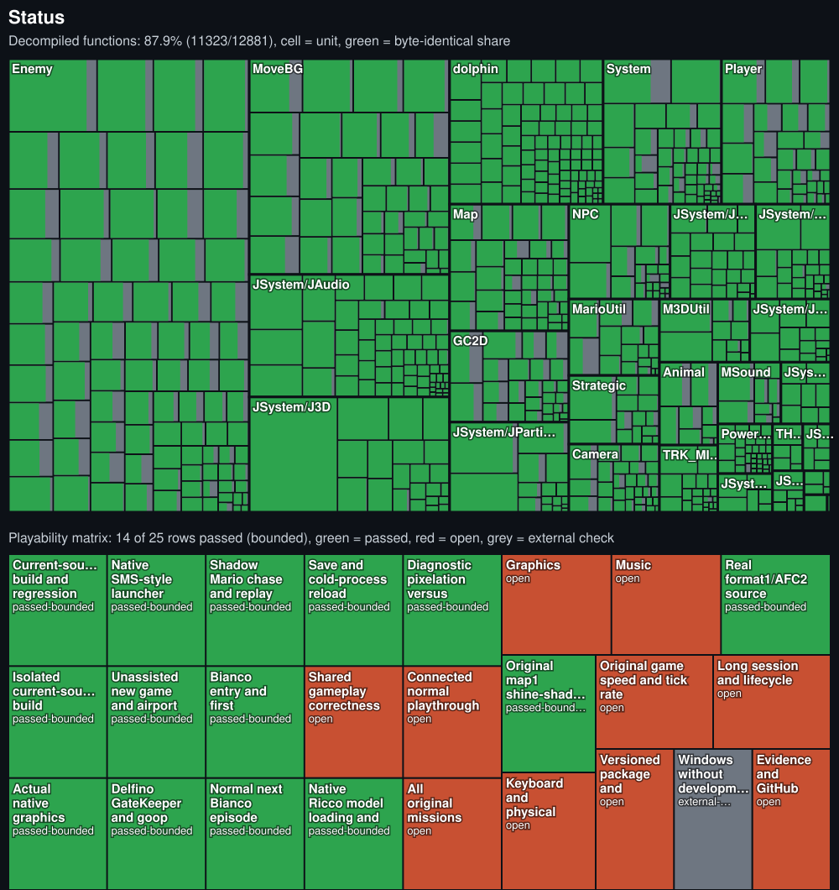

# Super Mario Sunshine for Windows (port in progress)

A native Windows x86-64 port of Super Mario Sunshine (GameCube, GMSJ01). The game code is the decompilation in `sms/`, compiled with clang-cl against [Aurora](https://github.com/encounter/aurora), which replaces the Dolphin SDK layer (GX, VI, PAD, OS, DVD, CARD). No emulator, no PowerPC code.

## Status

Generated by `python sunshine-pc/tools/status_treemap.py` from the objdiff report and the table below.

Not playable end to end yet. Legend: done = observed in a run or check, partial = works with gaps or unverified, open = not working. % is the lead's estimate of how much of the item works, not a measurement. Updated with every milestone. Last measured: 2026-10-14; the launcher, cheats/mods, audio, widescreen, particles and settings rows are synced to main after the KeyMatrix, Toggles2, FontFix, StageStart, T3 and HudAnchor landings, the other rows to `52c10f7` or earlier; runs on builds of main or of agent branches before landing.

**Decompilation progress (measured 2026-10-12, `sms/` full `ninja` + `changes_all` against a clean build of `d414ba0`):** 11 317 of 12 881 functions byte-identical = **87.9 %** (87.86); matched code **62.56 %** (by bytes); fuzzy match **98.64 %**; units complete **445 of 736 = 60.5 %**; data 87.5 %. DOL SHA-1 `9f5a8caf56f5356aeac9d3ed28bf8de976a03625` unchanged. About 1 560 functions are still not byte-identical (most of them between 98.5 % and 100 %). The numbers are measured from `report.json`; they are refreshed after every decomp round.

| Area | State | % | Evidence / gap |
| --- | --- | ---: | --- |
| Matching decomp build (SHA-1 `9f5a8caf…`) | done | 100 | `ninja` in `sms/` |
| Decomp logic correctness (non-matching functions) | partial | 55 | 11 317/12 881 functions bytegleich (62.56 % code, 98.64 % fuzzy), 445/736 units Matching; ledger `sunshine-pc/docs/decomp-verified.tsv` (2026-10-12, rows counted by status prefix; some functions have several rows under different name spellings): 1 983 `logic-verified` + 149 `matched` rows, 255 `partial` rows; rows written by agents were only partly audited, and the open list still holds several hundred game functions without a finished equivalence review (most blocked by header-inline codegen). Own code is allowed where byte-identical is not reachable if behaviour equals retail. Asm-proven bug fixes include inverted branches, wrong case sets, wrong members/offsets/constants/indices (e.g. CardLoad scale 1.5f, camera sub-stick axes, Kumokun velocity member, `TModelWaterManager::move` ground probe and state-2 plane store). Changes against the clean `d414ba0` baseline were compared per function with `changes_all`: 227 changes, 200 functions improved, 3 got worse (asm-proven behaviour fixes) |
| Strict link, 0 unresolved symbols | done | 100 | `tools/_strict.cmd` |
| Units compiled (clang-cl) | done | 100 | 583/583 built units, 149 excluded with 27 prefix rules and reasons (`sunshine-pc/excluded-units.txt`, `docs/platform-notes.md`) |
| Boot: logo, intro movies | done | 100 | normal `--dvd` boot |
| Title screen | partial | 85 | logo, Shine Sprite, seagulls render, logic 30/s; sky and clouds behind the logo render since 2026-10-13 (the option/title camera never set its far plane: `mFar` 10000 clipped the sky sphere of radius 100000; port-only fix in `sms/src/Camera/cameragc.cpp`, WARP screenshots `t_600.png` before/after); no retail reference image to compare colours and positions |
| Title → file select → new game → Delfino | partial | 75 | accepted dev-assisted chain (user decision via Main, 2026-10-13): route `sunshine-pc/tools/routes/85_accept_no_shine2.dev` (route 72 without `shine 2`) goes logo → option map → card prompts → new game → airport0 → airport boss → airport Shine → Delfino (stage 1) → Delfino boss → shadow Mario → gate → Bianco Ep.1 (stage 2 scen 0, no Bianco Shine); route `86_accept_reload.dev` reloads the card; real time (no `SUNSHINE_DEV_STEP_RETRACE`, no `SUNSHINE_DEV_SKIP_MOVIES`), env `SUNSHINE_DEV_AIM_ASSIST=1` and `SUNSHINE_ALLOW_CPU_ADAPTER=0`; accA1 (1171 s wall) and accB1 (1001 s) rc=0. Earlier stepped runs of route 72 (`t72g`, `t72h`, 2026-10-12) rc=0. A script `TIMEOUT` exits with rc 3 (fixed 2026-10-12: `aurora_shutdown` runs from `atexit`; before, the static-destructor teardown fast-failed with `0xC0000409`). Without `SUNSHINE_ALLOW_CPU_ADAPTER=0` the game runs on the CPU adapter at about 21 ticks/s. A retail-input run at 30 Hz without dev switches does not exist (movies and loads alone exceed 330 s). The exit heap crash after a TIMEOUT (3 of 170 runs) is fixed in `32f3941`: the muted AI pump buffer is `thread_local` (forced interleaving: 4 of 4 faults before, 0 of 4 after; 18 of 18 natural TIMEOUT runs clean). The route 85 regression after `cfe7373` (runs rg85a, rg85b, rg85w, rc 3) is fixed: `26b6a78` (Aurora 0014, copy readback off on the Null backend) and `c86ed12` (route waypoints and a gate-facing step); route 85 passes again on Null (gn85a/gn85b, gclN1/gclN2) and WARP (gclW1) |
| Bianco Hills Ep.1 | partial | 75 | 10-minute soak 2026-10-13 (`bf86825`, WARP, page heap, dev start with scripted walk/spray/jump and the health/water cheats): rc 0, 647.2 game s, 0 fatal (report SoakBianco); reached in route 70 (`stage=2 scen=0`, Mario controllable, status `0x0000133F`); textured, HUD, Mario walks/jumps, camera follows; `bianco/0` ran stable for 100 s (normal and heap-check mode); the intermittent flat red/blue/purple screen at frame 600 (8 of 14 runs) is mitigated (zeroed plain new: 0 of 12 runs after vs 8 of 14 before), cause open (plain `new` returns zeroed memory since 2026-10-13; the uninitialised read itself is not identified) |
| First Shine + save + reload | partial | 75 | accepted chain: airport Shine (`shines=1`, collected by walking to it; `[INFERENCE]` that it counts as the exit Shine); route 85 ends at Bianco Ep.1 with `.gci` written and `gci_check.py` PASS in accA1 and accB1; route 86 reload rc=0 in acc86a and acc86b (`shines 0->1` after load; reload shines count not yet reconciled). Bianco 100-coin Shine only via the dev verb `shine 2` (`shines=2`); earlier return to Delfino `stage=1 scen=5`, `.gci` PASS, switch-free reload `stage=1 scen=5 shines=2` (`u05`, route `61_reload.dev`, file block B); the Bianco Shine is not collected by real input: an offline floor model (`tools/bianco_path.py`, `map.col` + `scene.bin`) finds none of the three Bianco Shines reachable on foot from the start (nearest is the 100-coin Shine, 7 069 units away in XZ and 2 498 above the reachable height); nozzle/jump mechanics would be needed (model only, not verified in the game) |
| Boss fights (airport and Delfino GateKeeper) | partial | 65 | airport boss dies with pad input only (`fightboss` bot, `tools/routes/76b_airport_boss_fight.dev`, no aim assist; 4 of 4 runs, kill about 930 ticks after the bot starts; the route also sets `cheat infinite_health` and `cheat infinite_water`, dev aids accepted by user decision via Main 2026-10-13, not retail input); the Delfino boss in the accepted chain needs `SUNSHINE_DEV_AIM_ASSIST=1` and `cheat infinite_health` (standing on dirty goop costs health; accepted dev aids, not retail input); pad-only Delfino failed in three attempts (every tested spot near the boss is goop; `sunshine-pc/docs/platform-notes.md`, "Delfino GateKeeper without aim assist (open, 2026-10-13)"); `infinite_water` and `godmode` are accepted dev aids, not retail input; the Delfino boss is reached on foot over three waypoints (no `tp`) |
| Delfino gate to Bianco | partial | 55 | route `72_boss_tpchase.dev` (route 70 with `chase tp=1`): the shadow Mario is hit with water until it goes down (64 hits; the crutch teleports Mario behind it every 60 ticks and sprays, not retail input), talk, gate walk-in on foot, spray opens the JellyGate, select menu (two port bugs fixed: `OSJoinThread` result, `TSelectMenu` message index and `break`), `stage=2 scen=0` controllable. Two consecutive runs on 2026-10-12 (`t72g`, `t72h`): rc=0, chase met after 421 ticks, `.gci` PASS, reload `stage=1 scen=5 shines=2` rc=0. The walking `chase` of route 70 fails in the current tree: 9 of 9 decided runs end `TIMEOUT chase`; a floor-grid planner passed 0 of 6. Observed: the single-file bisect on a clean `d414ba0` worktree found `sms/src/Map/MapCheck.cpp` (`checkFlag(0x4)` -> `checkFlag(0x8)`, retail asm 0x801DE8C0-0x801DE8C8 tests 0x8; the fix stays) as the only change that makes the walking chase stick; the shadow Mario flees along its replay links and Mario is stopped by walls (`map.col` wall x=4000, wall z=-4400, corner at (4088,303,-4450)). A walking chase that follows the shadow is open |
| Goop / pixel metric | partial | 70 | Logic cleans since `cfe7373` on a rendering adapter (WARP): each pollution layer pass renders offscreen at the map's size and Aurora patch 0013 (`GXSetCopyReadback`) writes the R8 copy back into `mPollutionMap`, 2-4 frames late (GameCube: 0). Runs goopRB6/7/8 (`tools/routes/95_goop_readback.dev`, dolpic/0, WARP): sprayed patch raw 0, `dirty=0` on it, goop outside stays polluted; the unfixed exe stays `dirty=1` everywhere. On the Null backend (`SUNSHINE_ALLOW_CPU_ADAPTER=0`) the readback is off since `26b6a78` (Aurora 0014: Null read back empty copies and zeroed the maps); the maps keep their load state there, so spraying does not clean on Null. Counters from the CPU map since `080e4fc`/`20c5992` (`sms/src/Map/PollutionCount.cpp`): route 96 (`96_goop_count_bianco.dev`, bianco/0, WARP) object counter 1 446 -> 36 -> 31, then the Bianco sink building rises; route 95 layer 0 14364 -> 14015 (report GoopCountLand). Not verified: hardware GPU, other goop and boss stages, fpsLimit != 30, window resize |
| Audio | partial | 80 | host DSP follows the ucode (static disassembly of `jdsp[]`, hash 0x56d36052): voices add `(vol*src)>>16` and auto-mixer voices use the ucode's integer quadrant law (`93a9a1c`); the output matrix adds the back/centre buses into L/R and each effect line reads its own send bus with two Q15 returns (`a49732c`). Clipping gone (paired old/new mix in one run): route 85 59 clip seconds -> 0, bianco/0 idle 111 -> 0, title 7 -> 0. The game is quieter than before, as on retail: mixer channels -6.02 dB, auto-mixer voices about -18.1 dB. Effect returns now reach the output (about -46 dB under the main bus at idle, -24 dB while spraying). THP movie audio L/R order fixed (`45015f6`; Entrance.thp, 4 of 4 points swapped before, retail order after). The title BGM stop at about 21.5 s is retail: the title jingle is one 11 s sequence without a loop. The earlier noise after ~20 s was seen once and not reproduced; the reproducible artefact was the clipping. The DSP overload voice steal is skipped on PC (`3a61348`; it stole sustained notes) and the master volume scales the AI output, THP included (`243b386`; report AudioRef). 10-minute soaks (WARP): Bianco 0 clips, 10 s RMS median -24.7 dBFS; Delfino median -25.1 dBFS, 0 clips, silent only at boot and stage load. Dev hook `SUNSHINE_DEV_AUDIO_STATS=<s>` (`4f4769a`) logs DSP buffer underruns, AI repeats and channel pools per line. PENDING (owner): a person listens to the WAV excerpts. Not verified: no LLE or console capture; ramp shape and the auto-mixer send law are still approximations |
| Particles | done | 85 | JPA loads and renders 2D and 3D particles (`tools/jpa_test.cmd Strict --scenes` passes 2226/2226 valid `.jpa` files across the disc, 151 311 peak particles, 0 failures; in-game `[status-jpa]` / `[shot-jpa]` in `99_particles_bianco.dev` runs `jpa_bianco_1` and `jpa_dolpic_2` show `drawn == emitters` (100 %) for all 30-47 3D emitters and 3-6 2D emitters, with 2D rainbow stars, 3D FLUDD spray + group-2 indirect distortion (`jpa_dolpic_2/jpa_spray1.png`) and GateKeeper smoke (`gk_skin_1/gk_tp300.png`) visibly rendered on screen); the null `EmitterViewObj` / `EmitterIndirectViewObj` perform-list entries are retail behaviour, not a port defect (`platform-notes.md` "ParticlesNull") |
| Unlocked framerate | partial | 30 | logic 30/s, replay/interpolation code present (replay crash, circle shadow, per-draw HUD and mirror fixes landed); 60/120/144 not verified (host load, "presents 0/s" counter). Logic below 30/s in route runs is explained at idle: route.py's screenshot monitor (`AURORA_SCREENSHOT_EVERY=60:live.png`) is the main cost; with it off, WARP holds 30/s at idle (bianco/0, at or above 30/s in 92.4 % and 93.3 % of one-second samples vs 54.5 % and 54.0 % with it); vsync off (Mailbox) did not raise the rate. [INFERENCE] WARP is not the cause (8 idle bianco/0 runs, report LogicRate2; host contention only half tested, no loaded run). The monitor-off runs used `AURORA_SCREENSHOT_EVERY=0:x`, which Aurora rejects and so disables; an empty value also disables it (`route.py` removes an empty `KEY=` since `ced1fdb`, and unset is off too). Replay fixes: crash at `fpsLimit > 30` (`3d224da`, `bac9d7e`), circle shadows drawn once per frame (`b22eec0`); replays interpolate model positions since InterpCheck (before, every replay drew the tick unblended; measured on Mario and his mirror model at logic 7.6-9.6/s, fps 60, WARP) |
| Widescreen | partial | 70 | Hor+ frame widths 1704x960 (16:9), 2240x960 (21:9) and 1536x960 (16:10, HUD at the 4:3 offset, one frame) observed, world scale equal to 4:3, 4:3 frame bit-identical to widescreen off (one scene, WARP); HUD at its 4:3 size and edge anchored since HudAnchor (2026-10-14: the 13 marker panes of `standard_1.blo` shift by ±(bx·15+8)/16 units per stack; 4:3 frame bit-identical, 0 of 1 228 800 px changed; left stack back at x 32..410 and the water gauge at a 99 px gap from the right edge at 16:9, MARIO ×03 and the ticker stay centred; before, everything sat at x(4:3)+2·bx, and before HudFix it was stretched by window width / 1280); a runtime widescreen switch does not move the HUD until the next start; all 5 aspects (4:3, 16:10, 16:9, 21:9, 32:9) verified with left stack at x 33 (31 at 32:9) and water tank at right gap 69 px (70 px at 16:9) (`aw_post_*`); pause dimming, save-prompt mask and scenario-intro bars span the full width at 16:9 (pause also 21:9); stage-start partial frames on a cold pipeline cache fixed by shipping `initial_pipeline_cache.db` (2026-10-14, `tools/pipeline_cache_seed.py`, 484 GX/Clear rows: cold-home `ss_seed_43` and `ss_seed_169b` are 0.0 % black from `d_008` through `d_048`, vs 87.1 % / 90.3 % without the seed, `platform-notes.md` "Stage start, measured"); 32:9 at 3416x960 shows the scene after the Aurora scissor fix (patch 0016); camera-cut reset NOT verified |
| Launcher, settings | partial | 80 | FSR1/scale/cheat rows persist to the INI, launcher screenshot rendered; audio output-device row (UI-6, `ec1c0eb`: the saved endpoint opens, a bogus id falls back to the Windows default with one log line; this host has one endpoint only); "Skip launcher" on the Interface pane (UI-8, `934ee78`: `[launcher] skip_launcher` starts `last_image` like `--dvd`, a bad disc shows the launcher; the Shift escape is code-read only); DLSS row wrap fix not visually verified; in-game menu UI-4a (R+Start or F1 opens the settings page over the frozen game, `7665296`, `bf86825`); saved settings observed in game: T1 (boot matrix), T2 (pixel diff), T4 (launcher -> INI -> game chain), T5 (INI keys and stick dead zone; fix: Aurora's first `PADInit` reset the key table), T6 (mods, nozzle one-shot) and T7 (key capture in the launcher, C-stick dead zone) done; T8 lists every launcher switch with its evidence (`sunshine-pc/docs/ui-plan.md`; 47 rows with cheats and mods: 42 with an effect observed in game, 10 of them set in the launcher and 30 from a pre-written INI, 3 launcher-only; KeyMatrix: each of the 20 key rows sets its PAD bit or axis and the old key goes silent, reset-keys restores the defaults); menu sounds (UI-15, `9034f0d`: four synthetic tones on their own SDL stream, Menu sounds switch; listening check pending); T3 2026-10-14: fullscreen reaches the desktop swapchain (`fullscreen=1` -> `Using framebuffer size 3440x1440`, shots at 3440x1440, control 1280x960) and the fps cap reaches the engine (`fps_limit=30`: `window presents 0/s` in 145/145 samples; 60/120/144/unlimited: nonzero presents in 130/143, 111/124, 106/119, 105/119), all under host load so the rates are not timing measurements; present rate per cap, logic 30 Hz and live toggling still open |
| Cheats, mods | partial | 75 | cheats verified by log (lives/coins held at 99); `infinite_health` effect observed in game 2026-10-13: over the Delfino boss fight health stays 7-8 with the cheat (real-time run `rt2`, `[cheats-state]` min 7) and falls 8 -> 0 without it (run `nh77a`); `infinite_water` holds water at 10000 under spray (without it 10000 -> 9720 in T1, 10000 -> 9816 in T4); cheats and mod ticks run once per logic tick since TickOnce (`b8e5530`; before, four times, once per `direct()` sub-step); mod data overlay observed (T6: a patched `common.szs` renames the stage in the pause menu; the old `message.szs` target is never opened); launcher rows "Unlock all nozzles" (T4: `nozzles=0x3FFFF` in the first stage; T6: also after loading a save, and after a game over before the first save since a port fix) and "Max coins" (T8: `coins=99`, 0 without) work; a crashing DLL mod (`faulty` example) is disabled after its fault and the game runs on (Toggles2), and `src/crash.cpp` ignores first-chance faults inside `mods_loader.cpp`'s SEH guard (`faulty_seh_1`: 0 `fatal` lines, 0-byte `crash.log`) |
| Controller glyphs | partial | 70 | Xbox/PlayStation/Switch/GameCube styles load and change the water-button glyph (PNGs); T2 2026-10-13, X icon crop vs xbox at the same tick: generic 0.00 (shows the Xbox set by design), playstation 59.7 (`x.png` is Square □ by design: `PAD_BUTTON_X` maps to West on PlayStation in Aurora `pad.cpp`), switch 82.0, gamecube 42.4 (MAD); A/B/Start slots not seen in a frame; keyboard style missing |
| FSR1 upscaling | partial | 55 | FSR1 pass observed in log at 429x322 → 1279x960 (`build/PortLauncherRun/fsr67_on.log`); T2 2026-10-13 (dolpic/0, scale 0.5, WARP): the old FSR1 changed the frame but was softer than bilinear (Laplacian variance 15.3 vs 25.2) and shifted up-left (best whole-pixel shift dx -2, dy -1), so FAIL; fixed by Aurora patch 0015 (FSR1Fix, same scene and scale: Laplacian variance 59.8 vs bilinear 24.6, best shift (0,0), no halo or ringing seen); WARP only, one scene; real GPU, 1:1 frames and a native reference NOT verified |
| DLSS | blocked | 0 | needs motion vectors and a D3D12 handoff Dawn does not expose (`docs/dlss-feasibility.md`) |
| Release package | partial | 70 | `package.py` zip rebuilt and smoke-run on 2026-10-14 (`build/RelPkg` Release build rc 0, 0 unresolved symbols, 20.3 MiB with `initial_pipeline_cache.db` (484 rows), VC runtime, DXC pair and 16 licence files, 0 missing imports, no game data, unpacked launcher and `--dvd` title run at `logic 30/s` OK); not tested on a clean PC, no installer, no signing |

Overall (mean of the rows): **71 %**.

Plan and order of work: [`ROADMAP.md`](ROADMAP.md).

## Legal

- No game data is in this repository. You need your own legally obtained copy of the GMSJ01 disc image. The game reads it at runtime (`--dvd <path>`).
- The port's own licence is not decided yet. Third-party licences are listed in `sunshine-pc/THIRD_PARTY_LICENSES.md` (to be pinned before release).

## Layout

- `sms/`: decompilation (nested repository, submodule after publishing). Changes to it stay behind `#if TARGET_PC`; the matching build must keep the reference SHA-1.
- `sunshine-pc/`: the port (CMake, `src/`, `include/`, tools, docs).
- `sunshine-pc/extern/aurora`: Aurora at upstream `50e5be3`, with the port's changes as patches in `sunshine-pc/patches/aurora/`.

## Build

Requirements:
- Windows 10/11 x86-64.
- Visual Studio 2022 (BuildTools or Community) with the MSVC x64 tools. `build.cmd` loads `vcvars64.bat` from there.
- clang-cl. Put it on `PATH`, or set `LLVM_BIN` to the folder that contains `clang-cl.exe`.
- CMake, Ninja, and Python 3 (`Python3` is required by `CMakeLists.txt`).

Steps:

    git clone --recurse-submodules https://github.com/Astrr00/SMSunshinePC.git
    cd SMSunshinePC
    python sunshine-pc/tools/apply-aurora-patches.py
    sunshine-pc\build.cmd

`apply-aurora-patches.py` applies the port's changes to the Aurora submodule. It is idempotent. The configure step warns if the series is not applied.

`build.cmd [target]` configures and builds the preset `windows-clang-relwithdebinfo`. The binary is written to `sunshine-pc/build/windows-clang-relwithdebinfo/` (from `binaryDir` in `sunshine-pc/CMakePresets.json`).

Run with your own disc image:

    sunshine-pc\build\windows-clang-relwithdebinfo\sunshine.exe --dvd "path\to\Super Mario Sunshine (Japan).rvz"

## Matching decompilation

`sms/` builds the original `mario.dol` with its own Python/Ninja system. Its SHA-1 must stay `9f5a8caf56f5356aeac9d3ed28bf8de976a03625` (GMSJ01). Run `ninja` inside `sms/` for that check; the port's build does not touch it.

### Update 2026-10-12 (measured): first full chain logos -> Bianco -> Bianco Shine -> save -> reload

Route `sunshine-pc/tools/routes/60_acceptance.dev`, run twice in a row (`h01`, `h02`): rc=0, 144 s and 147 s wall time, no `overrun`, no crash, 13 PNGs each (airport0 `ap0.png`, Delfino `dolpic.png`, gate `gate.png`, Bianco `bianco.png`, Shine get `shine_get.png`/`shine_get2.png`). Stages seen in `run.log`: 15 (option map) -> 0/0 -> 0/1 -> 1/0 -> 1/1 -> 2/0 (Bianco, `dir.state=4`, Mario steerable, status `0x0C400201`) -> 1/5. `shines=2`, `.gci` PASS (`tools/gci_check.py`), reload with `tools/routes/61_reload.dev` (file block B, real time): `stage=1 scen=5 shines=2`, rc=0 (`h05`).
Command: `python tools/route.py Strict tools/routes/60_acceptance.dev --name <n> --seconds 330 SUNSHINE_DEV_STEP_RETRACE=1 SUNSHINE_DEV_SKIP_MOVIES=1 SUNSHINE_DEV_AIM_ASSIST=1 SUNSHINE_ALLOW_CPU_ADAPTER=0`.
**What is NOT retail input (the chain is dev-assisted, so the acceptance wording "no dev switches" is not met):** `SUNSHINE_DEV_STEP_RETRACE` (logic faster than 30 Hz; the 144 s is not 30 Hz wall time), `SUNSHINE_DEV_SKIP_MOVIES`, `SUNSHINE_DEV_AIM_ASSIST` (faces the head, sets nozzle pitch, forces the crouch; the Delfino spray gate), script verbs `cheat infinite_health/infinite_water`, `tp` (pit/boss/gate positions), `tpem` (shadow-Mario chase), `shine 2` (touches the Bianco 100-coin Shine). Real: airport boss killed with water via assist + short `hold L` cycles, airport Shine taken by walking to it and pressing A, Delfino GateKeeper killed with water (flag `0x10384` in the log), gate walk-in, Bianco load.
Bug found and fixed on the way: `JAIData::initSeqParameter` left `mSeqHandle` 0 on PC, so `JAISeqEntry::storeBuffer` stopped the SE master sequence and `processFrameWork` crashed at the airport exit (session log section 38).

## More

- [`sunshine-pc/docs/status.md`](sunshine-pc/docs/status.md): status and blockers
- [`sunshine-pc/docs/platform-notes.md`](sunshine-pc/docs/platform-notes.md): technical notes for the port
- [`sunshine-pc/patches/aurora/README.md`](sunshine-pc/patches/aurora/README.md): Aurora patch series
- [`sunshine-pc/docs/publishing.md`](sunshine-pc/docs/publishing.md): publishing runbook
- [`Port.md`](Port.md), [`Goal-Port.md`](Goal-Port.md): work orders

### Update 2026-10-12 (later): route 70, fewer dev crutches

`sunshine-pc/tools/routes/70_boss_until.dev` run twice in a row (`u01` 153 s, `u02` 193 s wall, rc=0, no `overrun`, no crash, 13 PNGs, `gci_check.py` PASS, reload `stage=1 scen=5 shines=2`). Remaining dev: `cheat infinite_health`, `chase` (position read, real input), `shine 2`, env `SUNSHINE_DEV_STEP_RETRACE`/`SKIP_MOVIES`/`AIM_ASSIST`. Gone: `tp`, `tpem`, `killboss`. Not met: a real Bianco Shine without `shine 2` (no measured floor path to any of the three Shines), 330 s at real 30 Hz, no dev switches. Details: `sunshine-pc/docs/session-2026-10-11b.md` section 42.

### Update 2026-10-12 (decomp round 6): 11 282 / 12 881 functions byte-identical (87.6 %)

Measured after round 6: SHA-1 unchanged, 11 282 / 12 881 byte-identical (87.6 %), matched code 61.98 %, fuzzy 98.60 %, 445 / 736 units, strict link 0 unresolved, Aurora 11 patches, `TEMP-DEBUG` 0, route 70 smoke 1 of 2 complete (`p01` chase fall, the known flake). Details: `sunshine-pc/docs/session-2026-10-11b.md` section 52.

### Update 2026-10-12 (decomp round 5): 11 247 / 12 881 functions byte-identical (87.3 %)

Measured after round 5: SHA-1 unchanged, 11 247 / 12 881 byte-identical (87.3 %), matched code 61.48 %, fuzzy 98.27 %, 445 / 736 units, strict link 0 unresolved, Aurora 11 patches, `TEMP-DEBUG` 0, route 70 smoke 2 of 2 rc=0. Details: `sunshine-pc/docs/session-2026-10-11b.md` section 50.

### Update 2026-10-12 (decomp round 4): 11 191 / 12 881 functions byte-identical (86.9 %)

Measured after round 4: SHA-1 unchanged, 11 191 / 12 881 byte-identical (86.9 %), matched code 60.69 %, fuzzy 98.25 %, 445 / 736 units, strict link 0 unresolved, `TEMP-DEBUG` 0, route 70 smoke 2 of 2 rc=0. Details: `sunshine-pc/docs/session-2026-10-11b.md` section 49.

### Update 2026-10-12 (decomp round 3): 11 112 / 12 881 functions byte-identical (86.3 %)

Measured after round 3: SHA-1 unchanged, 11 112 / 12 881 functions byte-identical (86.3 %), matched code 59.67 %, fuzzy 98.23 %, 445 / 736 units, strict link 0 unresolved, `TEMP-DEBUG` 0, route 70 smoke rc=0. Details: `sunshine-pc/docs/session-2026-10-11b.md` section 47.

### Update 2026-10-12 (decomp pass): 11 020 / 12 881 functions byte-identical

After a 12-agent decomp pass (details in `sunshine-pc/docs/session-2026-10-11b.md` section 44), measured by the lead: DOL SHA-1 unchanged, matched functions 11 013 -> 11 020, units 445 / 736, fuzzy total 98.12 %, strict link 0 unresolved, `TEMP-DEBUG` 0. Several real behaviour bugs fixed (Koopa nerves, BathtubKiller, bossgesso, ModelWaterManager, fenceMove, Kumokun, GCConsole2).

### Update 2026-10-12 (decomp round 2)

Gates: SHA-1 unchanged, 11 020 / 12 881 functions byte-identical, 445 / 736 units, fuzzy total 98.23 %, strict link 0 unresolved, `TEMP-DEBUG` 0. Route 70 smoke after the edits: 3 of 6 runs complete; one chase fall, one rare crash in the shadow-Mario replay (`TEnemyMario::emReplayJumpToNearestNode`, run `v02`, cause open). Details: session log section 45.
