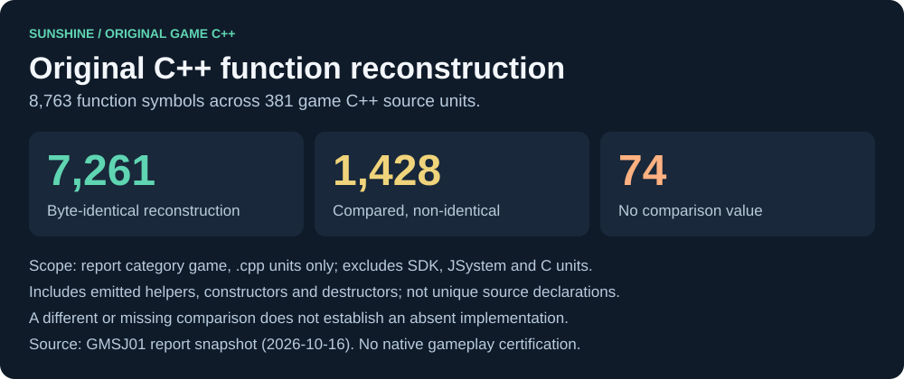
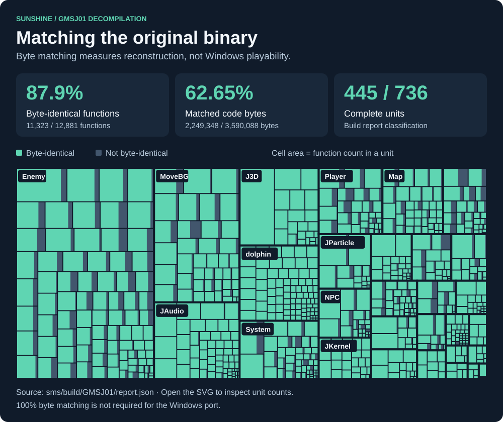

# Super Mario Sunshine for Windows

A native Windows x86-64 port of the Japanese GameCube release (**GMSJ01**), built from the decompiled game code and [Aurora](https://github.com/encounter/aurora). It runs native machine code; no emulator is required.

**In development. A complete, unassisted playthrough is not yet verified.** The goal is reliable original gameplay, saves and a reproducible Windows package. You need your own GMSJ01 disc image; this repository contains no game data. Release **v0.1.0 remains a draft**.

Support for US and European ROMs is planned for a future milestone.

[Roadmap](ROADMAP.md) · [Test and report bugs](sunshine-pc/docs/TESTING.md) · [Detailed status](sunshine-pc/docs/status.md) · [Build](#build-from-source)

## Playability

Normal controller-input routes have verified the airport, Delfino Gatekeeper and Shadow Mario, Petey Piranha, Gooper Blooper, Gelato's sandcastle mission, and Pinna's Mecha Bowser, Cannon/block secret, pirate-ship red coins, five sunflower turtles and the Ferris-wheel boss. Fifteen earned Shines have been saved and independently reloaded in fresh processes, including four [Delfino prerequisites for Pinna](sunshine-pc/docs/pinna-normal-route.md). These are bounded route results, not proof that every mission works. See the [normal world route evidence](sunshine-pc/docs/normal-world-routes.md) and [acceptance matrix](sunshine-pc/docs/playability-matrix.tsv).


Current work targets confirmed defects in shared gameplay code. Remaining acceptance includes normal progression through later worlds, all missions and collectibles, later-scene audio and graphics checks, long sessions, and final release packaging. A [Clean-PC test](sunshine-pc/docs/clean-pc-test-2026-10-19.md) passes for the private `0.1.0.20261019` package on a second Windows PC without development tools, including picture, sound, controls and a saved Shine after restart. Gelato's mirror route is deferred. Diagnostic loading of 91 later-world scenarios is recorded separately in [world-load coverage](sunshine-pc/docs/world-load-coverage.tsv); it does not establish normal mission completion.

The graphics are generated from recorded evidence, not live test runs. [Sources and regeneration](sunshine-pc/docs/img/README.md).

### Original C++ game functions

The GMSJ01 report snapshot records **8,763 original game C++ function symbols** across 381 `.cpp` units: **7,261 byte-identical reconstructions**, **1,428 compared but non-identical**, and **74 without a comparison value**.
The scope includes emitted helpers, constructors and destructors from units classified as `game`; it excludes SDK, JSystem, C files and new PC-port functions.



This counts emitted binary function symbols, not unique C++ declarations or verified native gameplay behavior.
A non-identical or missing comparison does not mean the implementation is absent; the report cannot supply a reliable implemented-versus-missing total for those functions.
The measurement snapshot is dated **2026-10-16**, like the broader matching chart below.
Normal-play evidence remains in the [gameplay-system catalogue](sunshine-pc/docs/gameplay-features.tsv) and [its graphic](sunshine-pc/docs/img/features.svg).
[Counting rules and regeneration](sunshine-pc/docs/img/README.md#regenerate).

## Build from source

Requirements:

- Windows 10 or 11, x86-64.
- Visual Studio 2022 Build Tools or Community, with the MSVC x64 tools. The build script loads `vcvars64.bat`.
- LLVM `clang-cl` on `PATH`, or `LLVM_BIN` set to its containing directory.
- CMake 3.25 or newer, Ninja, Python 3, and Git.

In PowerShell:

```powershell
git clone --recurse-submodules https://github.com/Astrr00/SMSunshinePC.git
cd SMSunshinePC\sunshine-pc
python tools\apply-aurora-patches.py
.\build.cmd
```

Run these commands from `sunshine-pc`. The patch script applies the required Aurora changes and is safe to run again. The build uses the `windows-clang-relwithdebinfo` preset and writes `build\windows-clang-relwithdebinfo\sunshine.exe`.

## Run

From `sunshine-pc`, open the native launcher:

```powershell
.\build\windows-clang-relwithdebinfo\sunshine.exe
```

Choose your Japanese disc image, wait for **Ready to play**, then select **Play**. Settings are saved automatically. Hold **Shift** at startup to show the launcher when **Skip launcher** is enabled.

To start directly with your disc:

```powershell
.\build\windows-clang-relwithdebinfo\sunshine.exe --dvd "C:\Games\Super Mario Sunshine (Japan).rvz"
```

For testing and bug reports, follow the [testing guide](sunshine-pc/docs/TESTING.md). Include the stage, episode and reproduction steps. An empty crash report is normal; attach logs without disc images or other game data.

Normal starts automatically save session and crash logs under `%APPDATA%\Sunshine\logs`, including in Release builds.
Run the packaged `collect_logs.cmd` to export `%APPDATA%\Sunshine\sunshine-logs.zip` for a bug report; no development tools are needed and nothing is uploaded automatically.

## Development checks

The strict developer build rejects unresolved symbols. From `sunshine-pc`:

```powershell
python tools\locked.py cmd /c tools\_strict.cmd
.\tools\port_tests.cmd
```

The build must report `STRICT: 0 unresolved symbols`; its executable is `build\Strict\sunshine.exe`. Build and host checks do not establish gameplay correctness. The [roadmap's Resume section](ROADMAP.md#resume) contains the focused regressions and native route commands, with their evidence and limits.

## Matching the original game

Matching compares the reconstructed GameCube binary with GMSJ01. It is a separate measure from Windows playability; 100% byte matching is not a prerequisite for the port.



This checked-in snapshot comes from the full matching report measured on **2026-10-16**. The treemap weights units by function count; green marks byte-identical functions. It does not show how much gameplay is complete. See [decompilation rounds](sunshine-pc/docs/decomp-rounds.md) for the audit history.

The independent `sms/` build reconstructs `mario.dol`. Its reference SHA-1 is `9f5a8caf56f5356aeac9d3ed28bf8de976a03625`. In an already configured matching checkout, run `ninja` inside `sms/` to verify it; the Windows build uses a separate build directory.

## Repository and documentation

- [`sms/`](sms/): decompiled game code and its independent matching build.
- [`sunshine-pc/`](sunshine-pc/): Windows platform layer, launcher, CMake build, tools and tests.
- [`Aurora patches`](sunshine-pc/patches/aurora/README.md): required changes to the Aurora submodule.
- [Platform notes](sunshine-pc/docs/platform-notes.md): architecture and platform behavior.
- [Release checklist](sunshine-pc/docs/release-checklist.md): remaining packaging and release requirements.
- [README history](sunshine-pc/docs/readme-history.md): archived development notes.

## Game data and licences

Use your own legally obtained GMSJ01 disc image. No game data is distributed here.

The port's own code and artwork use the [MIT licence](sunshine-pc/LICENSE); the decompilation uses [CC0](sms/LICENSE). See [third-party licences](sunshine-pc/THIRD_PARTY_LICENSES.md) for dependencies.
